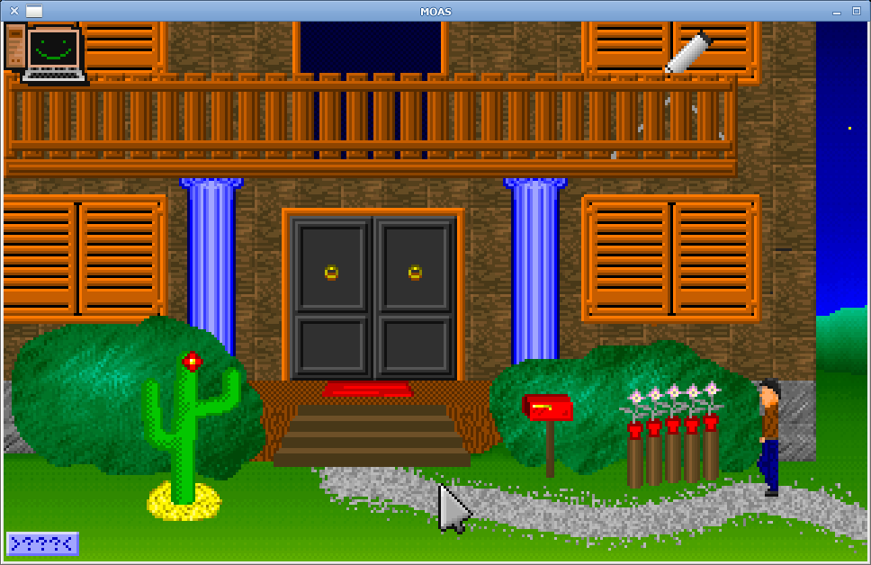

# MOAS — Mouse Orientiertes Adventure System

MOAS is a point-and-click adventure **engine** originally written in C by
Thomas Holz around 1992–2000 for DOS. This repository is a work-in-progress
port using SDL2: the original game logic stays intact while DOS hardware and
services are replaced by a modern platform layer.

The shipped product / window title is **Mänick Mänschion** (the adventure that
runs on this engine). The binary, package id, and icon theme name remain
`moas` / `org.grumbel.moas`.

**Original game (Thomas Holz):** <http://www.thomasholz.de/manick.htm>

The port is still under active development; timing, audio, and some legacy
effects may not yet match the original DOS release.

## Screenshot



## Current status

- SDL2 window, display, mouse, keyboard, and event handling
- Original 320×200, 256-colour software-rendered graphics
- Original script/bytecode interpreter and game data loading
- SDL audio output for digitized tracker samples (14 kHz, unsigned 8-bit mono)
- DOS save-game structures adapted to a packed on-disk layout
- Debug logging for scripts, input, waits, windows, and data loading
- FreeDesktop integration (`.desktop`, hicolor icons, AppStream metainfo)
  under the name **Mänick Mänschion**
- Cross builds: Windows (MinGW), Android (APK with packed `manick/` assets),
  WebAssembly (Emscripten + ASYNCIFY), R36S/PortMaster
- **`moas-util`**: list/extract data resources, disassemble scripts, extract strings for translation

Known limitations include unfinished speech-channel wiring and legacy effects
such as `PowerBlend` and `WalkNLayers`. Optional music banks (`GAME*.TSS`) are
not in the bundled data, so tracker music is silent unless those files are
added separately. See [TODO.md](TODO.md) for current porting notes.


## Development shell (`nix develop`)

Out-of-tree **Debug** builds (package builds stay RelWithDebInfo):

```sh
nix develop
moas-configure && moas-build
moas-run
moas-run --load=0
moas-run-gdb --load=0          # gdb: auto-run; stays open on crash
# or: nix develop -c moas-run-gdb
```

| Variable | Default |
|----------|---------|
| `MOAS_SOURCE` | `$PWD` (flake root) |
| `MOAS_BUILD_DIR` | `/tmp/moas-build` |
| `MOAS_DATADIR` | `$MOAS_SOURCE/manick` |
| `CMAKE_BUILD_TYPE` | `Debug` |

Scripts refuse to run unless `MOAS_SOURCE` is set (enter via `nix develop`).
`moas-build` reconfigures if the CMake source path changed.

## Build and run

### Requirements

- C compiler with C99 support (GCC or Clang)
- CMake 3.16 or newer
- SDL2 development libraries (`moas-util` needs only a C99 toolchain)
- `pkg-config` (useful for dependency discovery)

On NixOS, the supplied flake provides a build environment and package:

```sh
nix develop
cmake -S . -B build
cmake --build build
./build/moas
```

The development shell sets `MOAS_DATADIR` to the repository's `manick/`
directory by default. Outside that shell, run from the repository root or set
the data directory explicitly:

```sh
MOAS_DATADIR="$PWD/manick" ./build/moas
```

You can also configure and build directly with CMake on other Linux systems:

```sh
cmake -S . -B build -DCMAKE_BUILD_TYPE=RelWithDebInfo
cmake --build build --parallel
MOAS_DATADIR="$PWD/manick" ./build/moas
```

To build and run the Nix package directly:

```sh
nix run .
# or: nix build .#moas && ./result/bin/moas
```

The CMake install target installs the executable, game data, FreeDesktop
`.desktop` entry, hicolor icons, and AppStream metainfo under the configured
prefixes. After `cmake --install`, the game appears in application menus as
**Mänick Mänschion**.

## Cross-platform packages (Nix)

All of the following require Linux host tools and the flake inputs (SDL2
source, Android SDK where needed).

### MS-DOS (Open Watcom / DOS/4GW)

Cross-compiles the original `#ifdef DOS` code with Open Watcom from Nix:

```sh
nix build .#moas-dos          # $result/dos/moas.exe + GAME.* + DOS4GW.EXE
nix build .#moas-dos-zip      # zip of the same folder
nix run .#moas-dos            # Watcom rebuild under DOSBox-X
nix run .#moas-dos-original   # historical manick/GAME.EXE under DOSBox-X
```

Open Watcom is licensed under Watcom-1.0 (redistributable; nixpkgs marks it
unfree). The flake allows only the Open Watcom package names via
`allowUnfreePredicate` — no global `allowUnfree`.

Run the result under DOSBox or FreeDOS with the shipped data files next to
`moas.exe`. The historical `manick/GAME.EXE` remains the reference original
binary.

### Windows (MinGW)


```sh
nix build .#moas-win64          # 64-bit
nix build .#moas-win64-zip      # zip with SDL2.dll + data
nix build .#moas-win32
nix build .#moas-win32-zip
```

See `nix/windows.nix`.

### Android

On Android, letterbox **touch buttons** (SDL overlay, not the 320×200 buffer):

- **Left:** Save (top), Load (bottom) — F5 / F7
- **Right:** Esc (top), Skip (bottom) — Esc aborts armed sequences; Skip acts like **Shift** (speed up / dismiss speech)


```sh
nix build .#moas-android         # moas-<version>.apk
nix run .#install-android-moas   # install on a device with adb
```

NDK build of `libmain.so` against a prebuilt SDL2, packaged with SDL’s Java
activity (`nix/android.nix`, `mk/android/`). Game data from `manick/` is
packaged as APK assets and extracted to internal storage on first run
(`MOAS_DATADIR`). Useful logcat filter:

```sh
adb logcat -s SDL/APP:V MOAS:V *:E
```

### WebAssembly (Emscripten)

```sh
nix build .#moas-wasm
nix run .#moas-wasm              # local HTTP server + open browser
```

Static SDL2 for wasm32 and a self-contained site (`moas.html` / `.js` /
`.wasm` plus preloaded game data). Header globals use a single definition
TU under Emscripten; the blocking DOS-style game loop uses ASYNCIFY so
`Wait` / `getch` can yield to the browser (`nix/wasm.nix`, `mk/wasm/`).

The HTML shell (`mk/wasm/shell.html`) provides:

- **Fullscreen**, **Pause/Resume**, **Download saves** / **Upload saves…**
- Help text for mouse, touch, and keyboard
- **IndexedDB** persistence for `/moas-state` (IDBFS; requires `-lidbfs.js`)
- On-canvas touch overlay (Save / Load / USE / LOOK / Esc / Skip), same as Android
- **Gamepad:** left stick/D-pad walk, right stick cursor, RT use, LT look, A skip, B/Start Esc

Save files are exported as `moas-saves.json` and can be imported on another browser.

### R36S and other PortMaster handhelds (ArkOS)

```sh
nix build .#moas-r36s-portmaster-zip   # for PortMaster autoinstall
nix build .#moas-r36s-portmaster       # or copy contents to /roms/ports/
```

Cross-compiled against an Ubuntu 19.10 arm64 sysroot (`nix/r36s.nix`) so the
binary runs on ArkOS’s glibc and SDL2. Controls and install notes:
`mk/r36s/README.md`. Launch with `--fullscreen`.

## Translation strings

Script dialogue and object names live as packed tokens in `GAME.PCK` and as
packed byte sequences inside program resources. Extract everything for
translation (UTF-8):

```sh
moas-util --datadir manick strings json > manick.de.json   # id/source/target catalog
moas-util --datadir manick strings pot  > manick.pot
moas-util --datadir manick strings tsv  > manick.tsv
```

Each row has a stable `id` (`script.pN.0xADDR`, `pck.K`, or `ui.*`), the
source text, and a short reference. UI verb templates and save/load prompts
from the SDL port are included under `ui.*`.

### Runtime language packs (no gettext)

```sh
moas --lang=en
# or: MOAS_LANG=en moas
```

Loads `lang/<code>.ui` (index-based UI strings) and `lang/<code>.script`
(German line → translation, applied inside `UnPack`). Search path:
`$MOAS_LANGDIR`, `$MOAS_DATADIR/lang`, `$MOAS_DATADIR/../lang`, `./lang`.
Default `de` keeps built-in German UI and original script text. Sample
English UI: `lang/en.ui`. Build a full `en.script` from the TSV extract.

## Game data (`manick/`)

| File | Role |
|------|------|
| **GAME.2** | Resource **catalog** (counts + 30-byte records: file, offset, length, checksum) |
| **GAME.1 / .3 / .4** | **Containers** referenced by the catalog (`FileNum` 1 / 3 / 4) |
| **GAME.XXX** | **Fonts** (seven bitmap faces) |
| **GAME.PCK** | **String dictionary** for packed script text (`UnPack`) |
| **LICENCE.DAT** | Short licence line + checksum (startup) |
| **GAME.EXE**, **DOS4GW.EXE** | Original DOS binary + extender — **not** used by the SDL port |

Catalog **kinds** (tables inside `GAME.2`):

| Kind | Meaning |
|------|---------|
| **prog** | Script bytecode (`Execute`) |
| **bild** | Room / background pictures |
| **inv** | Inventory item sprites |
| **phase** | Character / object animation frames |

Optional files not in this tree: `GAME.MAP` (DOS disk-id check; skipped if
missing), `GAME*.TSS` (music sample banks).

## Data inspection (`moas-util`)

Standalone helper (no SDL). Built with the same CMake tree:

```sh
cmake -S . -B build && cmake --build build --target moas-util

./build/moas-util --datadir manick info
./build/moas-util --datadir manick list
./build/moas-util --datadir manick extract --outdir /tmp/moas-out [all|prog|bild|inv|phase]
./build/moas-util --datadir manick disasm [N]   # script program N, or all
./build/moas-util --datadir manick licence
./build/moas-util --datadir manick xxx          # GAME.XXX font summary
```

`MOAS_DATADIR` is used if `--datadir` is omitted.

- **list** — every catalog entry (kind, index, container file, pos, length)
- **extract** — raw resource blobs (not decompressed)
- **disasm** — linear disassembly of **prog** scripts using the engine’s
  opcode map; packed strings decoded via `GAME.PCK`

## Controls

### Save and load

| Key | Action |
|-----|--------|
| **F5** | Open the **save** menu (“Speichern”) |
| **F7** | Open the **load** menu (“Laden”) |

On the menu, **click a slot** (small framed boxes on the left/right). Slot **9** is reserved for the **script checkpoint** autosave (`AutoSaveGame` / `GAME9.SAV`) and cannot be chosen manually for save.

Save files are named `GAME0.SAV` … `GAME9.SAV` under the **state directory** (printed at startup), for example:

```text
~/.local/state/moas/GAME0.SAV
```

**Exit resume file:** on a normal quit (window close / quit request) the engine writes `AUTOSAVE.SAV` in the same state directory and restores it on the next start (skips intro, like `--load`). Use `--no-autosave` to disable both write-on-exit and restore-on-start. Explicit `--load=…` still takes priority over `AUTOSAVE.SAV`.

Overrides: `MOAS_STATEDIR`, or `XDG_STATE_HOME` (Linux).  
DOSBox runners persist to `~/.local/state/moas-dos` / `moas-dos-original`.

**Load:** press **F7**, then click a slot that shows a thumbnail (empty slots do nothing useful).  
Or from the shell: `moas --load=0` (see command-line options).  
**Save:** press **F5**, then click an empty or occupied slot (0–8).

You need **player control** and no dialogue window open (`Window.Status == None`); during cutscenes or forced walks these keys are ignored.

### Mouse

| Action | Effect |
|--------|--------|
| **Left click** | On an object: interact (use / talk / grab). On **empty ground** (non-DOS / touch): **walk** there. Menus and UI as usual. |
| **Right click** | Empty ground: walk (original DOS). On object: look (`SIEHE`). Also **S** key. |
| **Drag (grab+pull)** | Bewege mode — cursor becomes a **directional arrow** |

On Android there is no right button. Left-column HUD toggles (**USE** / **LOOK**, under Save/Load):

| Mode | Empty ground | Object |
|------|----------------|--------|
| **USE** (default) | Walk | Use / talk / grab+pull (desktop left-click) |
| **LOOK** | Walk | **Siehe** (look) — desktop right-click on object |

Pull (`Bewege`) only runs in **USE** mode. Arrow keys work with a keyboard. **Back** exits the activity fully.

### Movement and inventory

| Key | Action |
|-----|--------|
| **Arrow keys** / **Home/End/PgUp/PgDn** | Walk in that direction (when idle) |
| **Keypad 5** | Stop directional cursor nudge |
| **Tab** | Toggle inventory bar |
| **Space** / **Enter** | Advance dialogue / confirm (also used with on-screen prompts) |
| **S** | Same as right mouse button (when you have control) |
| **;** (semicolon) | “Use” verb shortcut (`BENUTZE`) when you have control |
| **F10** | File menu (when the window layout allows it) |
| **Shift** | Speed up / dismiss **speech bubbles** only (see below) |
| **Esc** | Abort a **scripted sequence** when the script has armed skip (see below) |
| **Q** / **Ctrl+C** / **Alt+F4** | Quit (SDL port) |

### Esc vs Shift (skipping)

These are **not** the same:

| | **Esc** | **Shift** |
|---|---------|-----------|
| **What it skips** | Whole scripted beats (waits, blends, forced walks, multi-step cutscenes) | Speech bubble text timing only |
| **When it works** | Only after a script opcode arms skip (`KeyAbortState = 1`) | Whenever a say-window is on screen |
| **Effect** | Sets `KeyAbortState = 2` — remaining ops in that sequence jump/abort | Holds: text timer runs faster; edge/Middle mouse: timer → done (`Time = -1`) |
| **Free play** | Ignored (does **not** freeze or quit) | No effect if nobody is talking |

**Shift** matches original DOS keyboard flag `0x417` (either Shift key). **Middle mouse** does the same as a Shift edge for speech.

Android **Skip** is wired like **Esc** (sequence abort), not Shift.

### Master / debug keys

Enable master mode only if the environment variable **`THPRIV`** is set, then press **T** (scancode path) to toggle `V_Master`.

When master mode is on:

| Key | Action |
|-----|--------|
| **P** | Show mouse coordinates |
| **1** | Full screen redraw |
| **2** | Outline walk/label markers (`ShowMarker`) |
| **I** / **J** | Blit `Info1` / `Info2` overlays |
| **P** (scancode 25) | Redraw all persons |
| **B** | Free some memory (debug) |
| **#** | Hercules debug dump (stderr on non-DOS) |
| **-** | Export label rectangle tool (console prompt) |

These are developer tools from the original engine, not needed for normal play.


## Command-line options (game)

```text
-h, --help              Show help
-d, --debug=LIST        Enable comma-separated debug categories
--skip-intro            Skip the intro/title script
--proc=N                Start at program N
--addr=N                Start at an address in that program
--datadir=PATH          Game data directory (MOAS_DATADIR)
--statedir=PATH         Savegame directory (MOAS_STATEDIR)
--load=SLOT|FILE        Load a save at startup (slot 0–9 or path to .SAV)
--load SLOT|FILE        Same as --load=
--no-autosave           Do not restore/write AUTOSAVE.SAV on start/exit
-f, --fullscreen        Desktop fullscreen
```

Load a save without the in-game menu:

```sh
./build/moas --load=0
./build/moas --load=3 --statedir=$HOME/.local/state/moas
./build/moas --load=$HOME/.local/state/moas/GAME2.SAV
./build/moas --no-autosave   # fresh start; do not write AUTOSAVE.SAV on quit
```

`--load` implies `--skip-intro` (the save already holds game state).  
If no `--load` is given and `AUTOSAVE.SAV` exists (and `--no-autosave` was not passed), that file is restored the same way.

Debug categories are `script`, `input`, `wait`, `window`, `load`, and `all`.
For example:

```sh
./build/moas --debug=wait,input,window
./build/moas --skip-intro --debug=script
./build/moas --fullscreen
MOAS_DEBUG=all ./build/moas
```

## Repository layout

- `src/` — C game engine and SDL2 platform layer
- `tools/moas-util.c` — data list / extract / script disassembler
- `manick/` — Mänick game data (see above)
- `data/` — FreeDesktop `.desktop` file, hicolor icons, AppStream metainfo
- `mk/android/` — Android NDK/APK packaging scripts and templates
- `mk/r36s/` — PortMaster launcher, `port.json`, screenshot
- `mk/wasm/` — Emscripten HTML shell and helper scripts
- `nix/` — Windows, Android, R36S, and WASM derivations
- `docs/screenshot.png` — screenshot of the current port
- `TODO.md` — current implementation notes and outstanding work
- `flake.nix` — Nix development shell, packages, and apps

## Contributing / development notes

The main goal is to keep the original game logic intact and isolate platform-
specific behavior behind the platform layer. Consult `AGENTS.md` and `TODO.md`
before making changes; `TODO.md` records known gaps and suggested next steps.

## License

The source code is distributed under the GNU General Public License, version 2
or (at your option) any later version. See [COPYING](COPYING). Game data may be
subject to separate terms; consult the included `LICENCE.DAT` and the original
rights holders before redistributing it.
